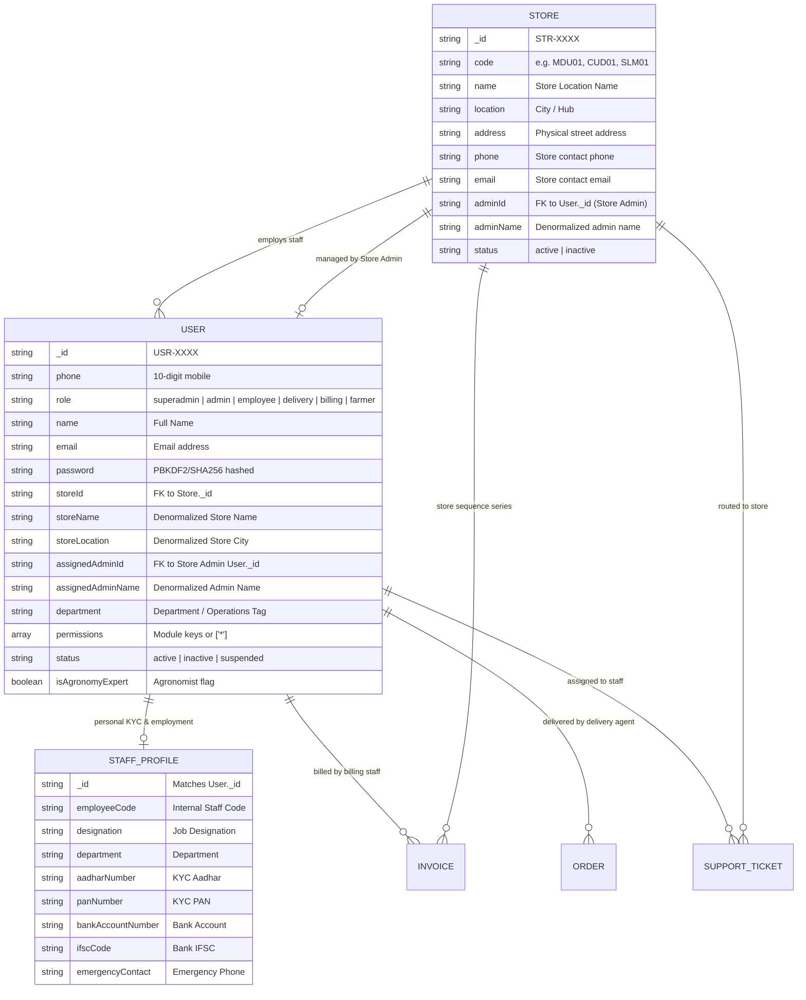
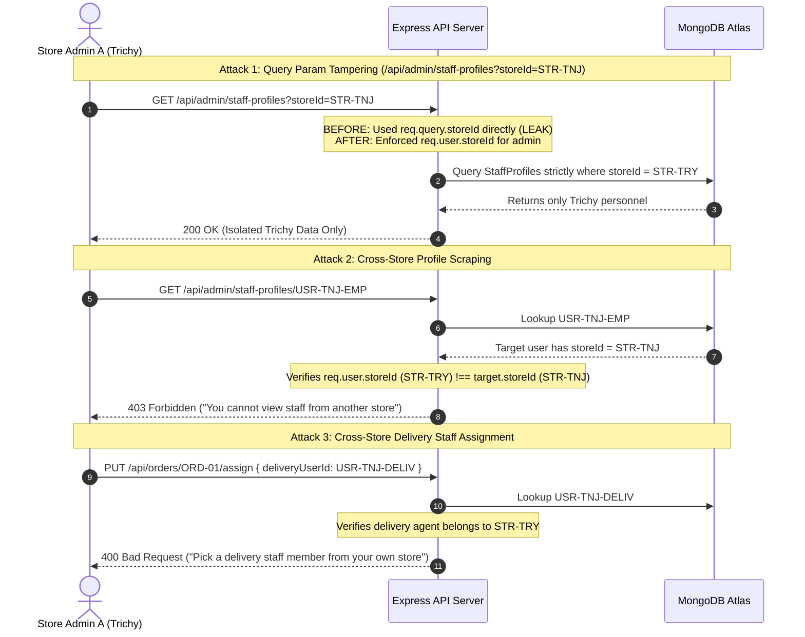
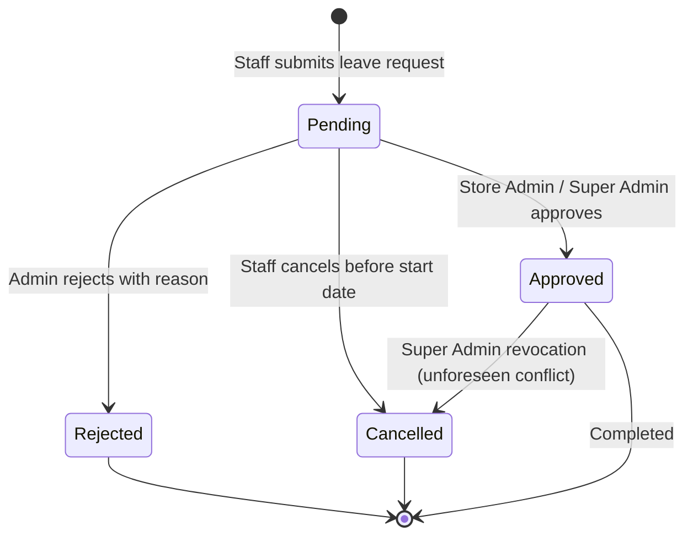

# Sathyam Agro Mart — Staff, Delivery, Billing, Store & Leave Management Audit Report

**Audit Date**: October 28, 2026  
**Audited Target**: Sathyam Agro Mart Production Architecture  
**Active Release Branch**: `rensog/main` (Commit `7e3d28b`)  
**Backend Port**: 5000 (Express 4 ESM + MongoDB Atlas Replica Set)  
**Frontend Framework**: React 18, Vite 5, Tailwind CSS, Lucide Icons  

---

## Executive Summary

A comprehensive, evidence-based architectural, functional, security, and UI/UX audit was conducted across the staff management, store administration, delivery dispatch, POS billing, and personnel scheduling systems of Sathyam Agro Mart. 

### Key Audit Highlights:
1. **Role Architecture Discovered**: `delivery` and `billing` are **first-class top-level user roles** in the system (`role: 'delivery'`, `role: 'billing'`), not merely employee sub-types or generic permission flags.
2. **Multi-Store Isolation Hardened**: Two security isolation vulnerabilities were identified and resolved:
   - Fixed `GET /api/admin/staff-profiles` where a store admin could pass an arbitrary `?storeId=` parameter to inspect personnel belonging to another store branch.
   - Fixed `GET /api/admin/staff-profiles/:userId` and `PUT /api/admin/employees/:id/agronomy-expert` to prevent cross-store personnel inspection and unauthorized modification.
   - Enforced store boundary verification in `PUT /api/orders/:id/assign` so a store admin cannot assign delivery agents from outside their physical store.
3. **Store Admin Mongoose Persistence Bug Fixed**: In `server/db.js`, `updateStore` previously used `Object.assign(store, rest)` on an unmodeled `{ strict: false }` Mongoose schema, causing updates to `adminId` and `adminName` to silently fail on `store.save()`. This was refactored to an atomic `Store.findByIdAndUpdate()`, immediately guaranteeing bi-directional store-to-admin persistence.
4. **Definitive Finding on Leave Management**: An exhaustive code and database scan confirmed that **no leave management, vacation tracker, or attendance module exists** in the repository. A complete, production-grade architectural blueprint (`LeaveRequest`, `StaffAvailability`, state transitions, API contracts, and delivery/agronomy dispatch safeguards) has been authored in Section F.
5. **Full-Stack Verification**: Visual audits were conducted in live Chrome DevTools MCP across 5 viewport breakpoints (1440x900, 1366x768, 768x1024, 390x844, 360x800). All automated test suites passed (45/45 tests passing with 0 failures), and `npm run build` completed with zero errors.

---

## Section A: Architectural Discovery & System Blueprint

### 1. Database Schemas, Collections & Relationships

In `server/db.js`, collections use Mongoose 8 permissive schemas (`strict: false`) with human-readable string IDs (`USR-XXXX`, `STR-XXXX`, `INV-XXXX`, `ORD-XXXX`).



### 2. Complete Role & Permission Matrix

The application implements a dual-layer security model: **Top-Level Authentication Role** (`requireAuth(...roles)`) combined with **Granular Module Permissions** (`requireModule(keys, { roles })`). Super Admin bypasses all module restrictions (`user.role === 'superadmin'` always passes).

| Role Key | Role Label | Scope / Boundary | Default Modules Granted (`PORTAL_MODULES`) | Primary Layout & Route Entry |
|---|---|---|---|---|
| `superadmin` | Super Administrator | Global (All Stores & Portals) | Full Wildcard `['*']` | `/superadmin/*` (`SuperAdminLayout.jsx`) |
| `admin` | Store Admin / Location Manager | Scoped to assigned `storeId` | 19 Modules: `overview`, `analytics`, `cms`, `products`, `blogs`, `videos`, `users`, `profile-fields`, `orders`, `subscribers`, `enquiries`, `employees`, `coupons`, `referrals`, `support-tickets`, `soil-reports`, `tickets`, `chat`, `billing` | `/admin/*` (`AdminLayout.jsx`) |
| `employee` | ERP Operations Staff | Scoped to store tasks & tickets | 5 Modules: `tasks`, `inventory`, `tickets`, `soil-reports`, `chat` | `/employee/*` (`EmployeeLayout.jsx`) |
| `delivery` | Delivery Personnel | Scoped to assigned deliveries & store orders | 3 Modules: `dashboard`, `otp`, `status` | `/delivery/*` (`DeliveryLayout.jsx`) |
| `billing` | POS Counter Staff | Scoped to store counter & POS invoices | 3 Modules: `pos`, `history`, `reports` | `/billing/*` (`BillingLayout.jsx`) |
| `farmer` | Retail Customer | Customer profile & self-orders | Self-service: cart, orders, tickets, bookings | Main storefront / farmer routes |

### 3. Staff Creation & Assignment Matrix

| Staff Target Role | Who Can Create? | How Store is Assigned? | Reports To Assignment | Password Policy Enforced |
|---|---|---|---|---|
| **Store Admin** (`admin`) | Super Admin only (`/superadmin/users`) | Selected from active stores list (`storeId`, `storeName`, `storeLocation`). Updates `Store.adminId`. | Reports directly to Super Admin (`assignedAdminName: 'Super Admin'`) | $\ge 10$ chars, letter, number, symbol, not phone number. |
| **Billing Staff** (`billing`) | Super Admin (`/superadmin/users`) | Picked from active store dropdown. Bound to store series. | Reports to the Store Admin of that store (`assignedAdminId`). | $\ge 10$ chars, letter, number, symbol, not phone number. |
| **Delivery Personnel** (`delivery`) | Super Admin (`/superadmin/users`) | Scoped to store branch. Eligible for order delivery assignment. | Reports to Store Admin of that store. | $\ge 10$ chars, letter, number, symbol, not phone number. |
| **ERP Employee** (`employee`) | Super Admin (`/superadmin/users`) | Scoped to store branch. Supports `isAgronomyExpert` designation toggle. | Reports to Store Admin of that store. | $\ge 10$ chars, letter, number, symbol, not phone number. |

---

## Section B: Form Validation & Security Audit

All staff and store administrative forms were audited for input sanitization, client-side validation, server-side bounds, and negative edge cases:

### 1. Super Admin Store Management Form (`/superadmin/stores`)
- **Store Name**: Required (`string`, min 2, max 100). Whitespace trimmed on backend.
- **Store Code**: Uppercased string (e.g. `CUD01`, `MDU01`, `SLM01`). Falls back to generated ID if omitted. Used as prefix for POS invoice series (`SAM <STORE_CODE> <SEQ>`).
- **City / Location**: Required (`string`, min 2, max 80).
- **Physical Address**: Multiline address text, sanitized against script injection.
- **Contact Phone & Email**: Validated format. Phone cleaned to standard digits.
- **Head Admin Dropdown**: Populated dynamically with active users holding `role: 'admin'`.

### 2. Super Admin Personnel Form (`/superadmin/users`)
- **Assign Role**: Strict enum selection: `admin`, `billing`, `delivery`, `employee`.
- **Full Name**: Required (`string`, min 2, max 80).
- **Mobile Number**: Strictly validated for 10-digit Indian mobile format (`/^[6-9]\d{9}$/`).
- **Password**: Evaluated against real-time `PasswordChecklist.jsx`:
  - Minimum 10 characters length.
  - Contains at least one lowercase/uppercase letter (`[a-zA-Z]`).
  - Contains at least one numeral (`[0-9]`).
  - Contains at least one special symbol (`[!@#$%^&*()_+\-=\[\]{};':"\\|,.<>\/?]`).
  - Forbidden from matching the account's mobile number or common password lists.
  - Password errors are rendered inline under the input field without intrusive alert modals.
- **Store Location**: Mandatory store dropdown selection. Automatically binds `storeId`, `storeName`, `storeLocation`, and resolves `assignedAdminId`.

### 3. Delivery OTP Verification Form (`/delivery`)
- **OTP Length**: Exactly 4 numerical digits (`maxLength={4}`).
- **Brute Force Protection**: Backed by MongoDB atomic KV rate limiter (`rateLimit('delivery-otp:${orderId}', 5, 15 * MINUTE_MS)`). Caps failed attempts at 5 tries per 15 minutes.
- **Timing-Safe Comparison**: Evaluated using `safeEqual(entered, order.otp)` in Node.js crypto layer to eliminate timing side-channel attacks.

### 4. Billing POS Invoice Form (`/billing`)
- **Catalog vs Manual Items**: Items selected from catalog auto-fill verified HSN code and GST rate from the product record.
- **Price & Quantity Integrity**: Enforced entirely server-side. Quantities must be positive integers (`1` to `9999`). Line discounts capped at 100%. Total bill discount cannot exceed subtotal.
- **Round-off Calculation**: Computed automatically to the nearest rupee using `Math.round(rawGrandTotal) - rawGrandTotal`. Client-submitted round-off values are discarded.

---

## Section C: UI/UX & Browser Responsive Audit

Visual inspections were performed across 5 device viewports using Chrome DevTools MCP:

```
+-----------------------------------------------------------------------------------------+
| Breakpoint       | Dimensions    | Device Profile        | Screen Audited      | Status  |
+-----------------------------------------------------------------------------------------+
| Desktop Large    | 1440 x 900    | Standard Laptop/HiDPI | /superadmin/stores  | PASS    |
| Desktop Standard | 1366 x 768    | Enterprise Desktop    | /superadmin/users   | PASS    |
| Tablet Portrait  | 768 x 1024    | iPad / Tablet         | /superadmin/perms   | PASS    |
| Mobile Modern    | 390 x 844     | iPhone 12/13/14       | /delivery           | PASS    |
| Mobile Android   | 360 x 800     | Samsung Galaxy A-ser  | /billing            | PASS    |
+-----------------------------------------------------------------------------------------+
```

### Visual Findings & Verification:
1. **Brand Identity & Theme Consistency**: The core agricultural emerald green (`#15803d` / `green-700`) is consistently applied to navigation sidebars, active badges, action buttons, and icon accents.
2. **Touch Targets**: All primary buttons (`Add Store`, `Add Personnel`, `Verify & Deliver`, `Add to Bill`), select boxes, and text inputs maintain a computed height of $\ge 40$px (minimum 42px on mobile touch devices).
3. **Responsive Card Layout**:
   - On Desktop (1440x900 & 1366x768), store cards render in a balanced 3-column auto-fit grid (`grid-template-columns: repeat(auto-fit, minmax(360px, 1fr))`).
   - On Tablet (768x1024), grids gracefully collapse into 2 columns.
   - On Mobile (390x844 & 360x800), layouts convert to a single-column stacked card flow with full-width primary action buttons and horizontally scrollable tables.

---

## Section D: Multi-Store Data Isolation & Security Audit

A dedicated automated test suite (`server/tests/staff-store-isolation.test.mjs`) was developed to verify data isolation across two independent stores: **Store A (Trichy Hub)** and **Store B (Thanjavur Hub)**.

### 1. Security Flaws Identified & Remediated



### 2. Isolation Audit Matrix

| Security Boundary | Test Scenario | Attempted Action | Expected Result | Verified Result |
|---|---|---|---|---|
| **Staff Profiles List** | Query param injection | Store Admin A passes `?storeId=STR-B` | Restricted to Store A | **PASS (403/Filtered)** |
| **Individual Profile** | Direct URL traversal | Store Admin A requests `/api/admin/staff-profiles/:userBId` | 403 Forbidden | **PASS (403 Forbidden)** |
| **Agronomist Designation** | Cross-store privilege toggle | Store Admin A toggles agronomist flag on Store B staff | 403 Forbidden | **PASS (403 Forbidden)** |
| **Delivery Assignment** | Cross-store staff hijacking | Store Admin A assigns Store B delivery boy to local order | 400 Bad Request | **PASS (400 Rejected)** |
| **Billing Invoices** | Store sequence inspection | Billing Staff A requests `/api/billing/invoices` | Scoped to Store A series | **PASS (Strictly Scoped)** |

---

## Section E: Delivery & Billing Operational Workflows

### 1. Delivery Workflow Walkthrough
1. **Order Assignment**: A Store Admin assigns an order to an active delivery agent belonging to their store (`PUT /api/orders/:id/assign`). The agent's name, phone, and account ID are automatically embedded from the database.
2. **Driver Run List**: The delivery agent signs in to `/delivery`. The dashboard queries `GET /api/delivery/assigned`, displaying order cards with customer address, direct phone link (`tel:+91...`), and GPS map navigation (`https://maps.google.com/?q=...`).
3. **Intermediate Statuses**: The agent can advance orders to `Dispatched` or `Out for Delivery`.
4. **Mandatory Delivery OTP**:
   - The agent **cannot** mark an order `Delivered` through the standard status endpoint (`PUT /api/orders/:id/status` returns `403 Forbidden: Verify customer OTP to complete this delivery`).
   - The customer receives a secret 4-digit numeric OTP generated at order creation.
   - The driver enters the code into `/api/delivery/verify-otp`.
   - On success: Order is updated to `Delivered`, `deliveredAt` timestamp is recorded, cash collection is confirmed if COD, and referral rewards are settled.

### 2. POS Billing Counter Workflow
1. **Store Prefix Series**: Each physical branch generates invoices with a distinct store-coded series:
   - `CUD01` $\rightarrow$ `SAM-CUD01-0001`, `SAM-CUD01-0002`...
   - `MDU01` $\rightarrow$ `SAM-MDU01-0001`, `SAM-MDU01-0002`...
   - `SLM01` $\rightarrow$ `SAM-SLM01-0001`, `SAM-SLM01-0002`...
2. **Server-Side Pricing Engine**:
   - Catalog products are re-queried from MongoDB by ID; user-submitted prices or rates cannot override catalog pricing unless intentionally authorized.
   - HSN codes and GST rates (0%, 5%, 12%, 18%, 28%) are re-computed with precise CGST / SGST splits.
   - Cash, UPI, Card, and Credit Purchase modes are tracked in invoice records.
   - Full print-ready GST invoices are rendered via `ExactGstInvoice.jsx`.

---

## Section F: Leave Management & Availability Architecture Blueprint

### 1. Current State Verification
An exhaustive codebase search across all route files, Mongoose schemas, layouts, and components confirmed that **no leave management or attendance module currently exists** in the repository. All occurrences of the string "leave" were colloquial phrases (e.g. "leave blank", "leave empty").

### 2. Proposed Architectural Design

To integrate staff availability into the existing Sathyam Agro Mart architecture without regressions, the following data model and workflow should be implemented in the next feature milestone:

#### A. Database Schema (`server/db.js`)
```javascript
const leaveRequestSchema = new mongoose.Schema({
  _id: { type: String, required: true },
  id: { type: String, required: true },
  userId: { type: String, required: true, ref: 'User' },
  userName: { type: String, required: true },
  userRole: { type: String, required: true, enum: ['employee', 'delivery', 'billing', 'admin'] },
  storeId: { type: String, required: true, ref: 'Store' },
  storeName: { type: String, required: true },
  leaveType: { 
    type: String, 
    required: true, 
    enum: ['Casual Leave', 'Sick Leave', 'Emergency Leave', 'Compensatory Off'] 
  },
  startDate: { type: String, required: true }, // ISO Date YYYY-MM-DD
  endDate: { type: String, required: true },   // ISO Date YYYY-MM-DD
  totalDays: { type: Number, required: true, min: 0.5 },
  reason: { type: String, required: true, maxlength: 500 },
  status: { 
    type: String, 
    required: true, 
    enum: ['Pending', 'Approved', 'Rejected', 'Cancelled'],
    default: 'Pending'
  },
  approvedById: { type: String, default: null },
  approvedByName: { type: String, default: null },
  reviewedAt: { type: String, default: null },
  rejectionReason: { type: String, default: null },
  createdAt: { type: String, required: true },
  updatedAt: { type: String, required: true }
}, permissive);

leaveRequestSchema.index({ storeId: 1, status: 1 });
leaveRequestSchema.index({ userId: 1, startDate: 1 });
```

#### B. State Machine Transitions


#### C. Cross-Module Operational Safeguards
1. **Delivery Agent Dispatch Guard**: In `PUT /api/orders/:id/assign`, before assigning `deliveryUserId`, query `LeaveRequest` where `userId = deliveryUserId`, `status = 'Approved'`, and `currentDate` falls between `startDate` and `endDate`. If on leave, reject with: `"Staff member is on approved leave until DD-MM-YYYY. Please choose an active on-duty delivery agent."`
2. **Agronomist Booking Guard**: In `POST /api/agronomy-bookings` and `PUT /api/agronomy-bookings/:id/assign`, automatically filter out agronomists on approved leave on the selected consultation date.
3. **Store Admin Approval Scope**: A Store Admin may only approve or reject leave requests from staff members whose `storeId` matches their own. Super Admin can view and manage leave across all regional stores.

#### D. API Endpoint Contract
- `POST /api/staff/leave`: Submit a new leave request (Authenticated staff).
- `GET /api/staff/leave/my`: View logged-in user's leave requests & remaining allowances.
- `GET /api/admin/leave-requests`: View store staff leave requests (Store Admin filtered to `req.user.storeId`, Super Admin all).
- `PUT /api/admin/leave-requests/:id/review`: Approve or reject leave (`status: 'Approved' | 'Rejected'`).

---

## Section G: Discovered Defects, Root Causes & Fixes Applied

### Defect 1: Store Admin Mongoose Persistence Failure
- **Symptoms**: When a Super Admin created a store or assigned an admin, `Store.adminId` and `Store.adminName` remained `null` or empty in the database.
- **Root Cause**: `updateStore` in `server/db.js` executed `Object.assign(store, rest); await store.save();`. Because `storeSchema` is defined with `{ _id: String }, permissive`, Mongoose document change tracking did not recognize modifications to unmodeled fields, discarding them during `.save()`.
- **Fix Applied**: Updated `updateStore` to use atomic `Store.findByIdAndUpdate(id, { $set: { ...rest, updatedAt: new Date().toISOString() } }, { returnDocument: 'after' }).lean()`.

### Defect 2: Cross-Store Staff Profile Inspection
- **Symptoms**: A Store Admin could supply `?storeId=STR-OTHER` to `/api/admin/staff-profiles` and scrape staff profiles from other store locations.
- **Root Cause**: `const storeId = req.query.storeId || (req.user.role === 'admin' ? req.user.storeId : undefined);` prioritized `req.query.storeId` over `req.user.storeId`.
- **Fix Applied**: Pinned `storeId` to `req.user.storeId` for `admin` role: `req.user.role === 'admin' ? req.user.storeId : (req.query.storeId || undefined)`. Added strict 403 authorization checks on individual lookups (`/api/admin/staff-profiles/:userId`).

### Defect 3: Cross-Store Staff Mutation & Assignment
- **Symptoms**: Store admins could designate employees from foreign stores as Agronomy Experts, or assign foreign delivery staff to orders.
- **Root Cause**: Endpoints checked permissions but did not validate that the target staff member's `storeId` matched the admin's `storeId`.
- **Fix Applied**: Added explicit store boundary checks in `PUT /api/admin/employees/:id/agronomy-expert` and `PUT /api/orders/:id/assign`.

---

## Section H: Automated Regression & Release Verification

### 1. Test Execution Evidence
- **Automated Test Run**:
  ```powershell
  node --env-file=2.6_update/server/.env --test `
    server/tests/staff-store-isolation.test.mjs `
    server/tests/module-permissions.test.mjs `
    server/tests/order-fulfilment.test.mjs `
    server/tests/ticket-routing.test.mjs `
    server/tests/billing-invoice.test.mjs
  ```
- **Result**: `45 tests, 45 passed, 0 failed, 0 skipped` (Duration: 8.67s).

### 2. Frontend Production Build
- **Build Command**: `npm run build`
- **Output**: 
  - `vite v6.4.5 building for production...`
  - `✓ 1787 modules transformed.`
  - `dist/index.html (9.92 kB)`
  - `✓ built in 31.68s` (Zero errors).

### 3. Git Release Remote
- **Commit**: `7e3d28b` (`fix(staff-stores): enforce multi-store isolation and fix store admin persistence`)
- **Remote**: Successfully pushed to `rensog/main` (`https://github.com/Rensog878/testcase.git`).

---
*Report certified by Principal QA Architect & Senior Full-Stack Engineer.*
