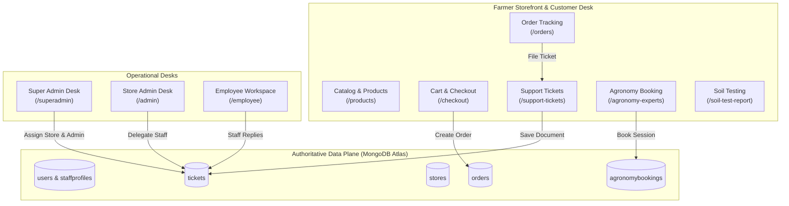
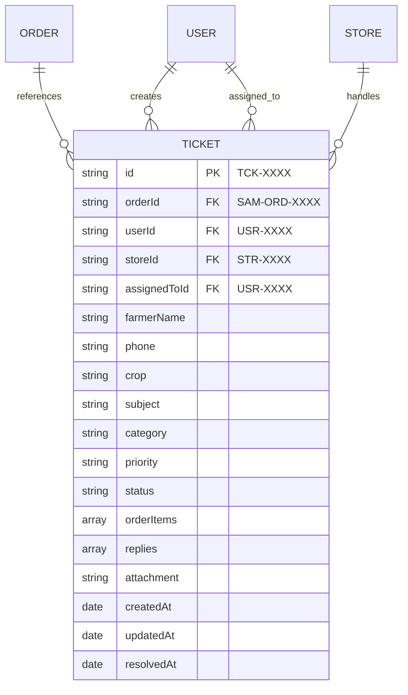

# SATHYAM AGRO MART — FULL PROJECT UNDERSTANDING, SUPPORT TICKET ARCHITECTURE AUDIT & IMPROVEMENT PLAN

**Document Version:** 1.0.0  
**Date:** 2026-10-27  
**Author:** Principal Software Architect & QA Automation Lead  
**Scope:** Architecture Discovery, Cross-Module Inventory, Support Ticket Audit, Defect Catalog & Re-Engineering Plan  
**Target Repository:** `Sathyam Agro Mart (2.6_update)`  

---

## 1. Project Architecture Overview

An empirical investigation was conducted across the Sathyam Agro Mart codebase (`2.6_update`) to establish the actual architecture from the source files.

### 1.1 Frontend Architecture
* **Core Framework**: React 18 with Vite 5.4.5, Tailwind CSS, Lucide React icon suite, Axios, and React Router 6.
* **Application Shell**: Single Page Application (SPA) entrypoint at [src/main.jsx](file:///c:/Users/step1/OneDrive/Desktop/2.6-test_cases/2.6_update/src/main.jsx) and dynamic route declarations in [src/App.jsx](file:///c:/Users/step1/OneDrive/Desktop/2.6-test_cases/2.6_update/src/App.jsx).
* **Global Contexts & State**:
  * [AuthContext.jsx](file:///c:/Users/step1/OneDrive/Desktop/2.6-test_cases/2.6_update/src/context/AuthContext.jsx): Manages authentication token (`sathya_token`), user state (`sathya_user`), and cross-tab session invalidation via `localStorage` event listeners.
  * [CmsContext.jsx](file:///c:/Users/step1/OneDrive/Desktop/2.6-test_cases/2.6_update/src/context/CmsContext.jsx): Real-time CMS content cache and dynamic promotional banner sync.
  * [LanguageContext.jsx](file:///c:/Users/step1/OneDrive/Desktop/2.6-test_cases/2.6_update/src/context/LanguageContext.jsx): Bilingual dictionary localization (English & Tamil).
* **Role-Based Portals & Layouts**:
  * `StoreLayout`: Customer-facing storefront, catalog, cart, checkout, and farmer account pages.
  * `SuperAdminLayout` (`/superadmin`): Head-office control center for platform analytics, store network, personnel, permissions, and audit logs.
  * `AdminLayout` (`/admin`): Store-level operational desk for catalog, orders, local inventory, support tickets, and store employees.
  * `EmployeeLayout` (`/employee`): Field staff and agronomist workspace for assigned tickets, advisory bookings, and soil reports.
  * `DeliveryLayout` (`/delivery`) & `BillingLayout` (`/billing`): Dedicated logistics and GST invoicing desks.
* **Route Protection**: Client-side enforcement via `<PrivateRoute allowedRoles={[...]} signIn={<Login />}>`.

### 1.2 Backend Architecture
* **Runtime & Framework**: Express 4 running on native Node.js ESM (`"type": "module"` in `package.json`).
* **Monolithic Core**: Central API gateway implemented in [server/server.js](file:///c:/Users/step1/OneDrive/Desktop/2.6-test_cases/2.6_update/server/server.js) (4,417 lines), supported by specialized modular engines:
  * [server/db.js](file:///c:/Users/step1/OneDrive/Desktop/2.6-test_cases/2.6_update/server/db.js): Mongoose database manager and data access abstractions.
  * [server/security.js](file:///c:/Users/step1/OneDrive/Desktop/2.6-test_cases/2.6_update/server/security.js): Password hashing (scrypt with constant-time comparison), token issuance, timing-safe equality checks, and data sanitization.
  * [server/ticketRouting.js](file:///c:/Users/step1/OneDrive/Desktop/2.6-test_cases/2.6_update/server/ticketRouting.js): Pure functional routing rules, store suggestions, and geocoded Haversine distance calculations.
  * [server/whatsapp.js](file:///c:/Users/step1/OneDrive/Desktop/2.6-test_cases/2.6_update/server/whatsapp.js): UltraMsg / WaSender integration for automated messaging.
  * [server/geocode.js](file:///c:/Users/step1/OneDrive/Desktop/2.6-test_cases/2.6_update/server/geocode.js): Geocoding engine mapping postal addresses and pincodes to coordinates.
  * [server/superadminRoutes.js](file:///c:/Users/step1/OneDrive/Desktop/2.6-test_cases/2.6_update/server/superadminRoutes.js): Enterprise control endpoints.
* **Rate Limiting & Brute Force Protection**: IP-based and user-key sliding window rate limits via `rateLimit` and `peekRateLimit` in KV store.
* **Dual Hosting Design**:
  1. Standalone production on Hostinger Linux VPS using PM2, serving both static assets from `dist/` and backend `/api/*` endpoints from a single Node process.
  2. Serverless deployment on Vercel via rewrite rules (`vercel.json`).

### 1.3 Database Architecture
* **Database Technology**: MongoDB Atlas (`sathyambio` replica set) managed via Mongoose 8.
* **Schema Design**: Permissive Schemas (`{ _id: String }, { strict: false, versionKey: false }`), allowing backwards-compatible field evolution while enforcing business validation at the API layer.
* **Key Collections**: `users`, `stores`, `products`, `orders`, `tickets`, `staffprofiles`, `agronomybookings`, `soiltestreports`, `auditlogs`, and KV key-value collection (used for rate limits, session invalidation, and geocode caching).
* **Identifier Conventions**: Human-readable prefixed string IDs:
  * Tickets: `TCK-XXXX`
  * Orders: `SAM-ORD-XXXX`
  * Users: `USR-XXXX`
  * Stores: `STR-XXXX`
  * Bookings: `AGR-XXXX`
  * Soil Reports: `SOIL-XXXX`

### 1.4 Authentication & Security Architecture
* **Token Structure**: Stateless HMAC-SHA256 signed tokens (`sb1.<base64url(payload)>.<signature>`) embedding user ID, session ID (`sid`), and password revision hash (`pv`). If a password is reset or a session terminated in the KV store, the token is invalidated immediately.
* **Session Persistence**: Tokens stored in `localStorage` (`sathya_token`) and HttpOnly / SameSite cookies (`token`).
* **Verification**:
  * `requireAuth(...roles)`: Extracts token from `Authorization: Bearer <token>` or `req.cookies.token`, verifies signature, fetches user, validates active status, checks session ID.
  * `requireModule(keys, { roles })`: Enforces granular RBAC based on permissions granted in `user.permissions`.

### 1.5 File Upload Pipeline
* Multipart file receiver in `POST /api/upload` writing to `server/uploads/` on disk (and serving publicly at `/uploads/*`).
* Guarded by `requireAuth('admin')` and `requireModule(['cms', 'products', 'blogs', 'videos', 'users'])`.

### 1.6 Communication & Notifications
* WhatsApp API integration via `server/whatsapp.js` using WaSender / UltraMsg.
* Active for WhatsApp OTP, password reset, order confirmation (`sendOrderConfirmation(order)`), and broadcast advisory campaigns.
* Currently **disconnected** from Support Tickets.

### 1.7 Testing & Verification
* Native Node test runner (`node --test`), 19 test suites in `server/tests/` (including `ticket-routing.test.mjs`, `phase2-support.test.mjs`, `product-crud-pricing.test.mjs`).

---

## 2. Module Inventory & Status Map



### Module Verification Matrix

| Module | Implementation Status | Frontend Routes | Backend Endpoints | Primary Dependencies |
| :--- | :--- | :--- | :--- | :--- |
| **Farmer Storefront & Catalog** | **Implemented** | `/`, `/products`, `/product/:id`, `/categories`, `/crops`, `/brands` | `GET /api/products`, `GET /api/categories`, `GET /api/brands` | MongoDB `products`, Image uploads |
| **Cart, Checkout & Payments** | **Implemented** | `/checkout`, `/cart` | `POST /api/orders`, `POST /api/payments/verify`, `POST /api/payments/webhook` | Razorpay SDK, server-side price recalculation |
| **Order Tracking** | **Implemented** | `/orders` | `GET /api/orders`, `GET /api/orders/:id` | MongoDB `orders`, WhatsApp confirmations |
| **Store Management** | **Implemented** | `/superadmin/stores` | `GET /api/stores`, `POST/PUT /api/superadmin/stores` | MongoDB `stores`, Geocoding engine |
| **Personnel & Employee Management** | **Implemented** | `/superadmin/users`, `/admin/employees` | `POST/PUT /api/superadmin/users`, `PUT /api/admin/employees/:id/agronomy-expert` | MongoDB `users`, `staffprofiles`, Store linkage |
| **Agronomist Advisory & Booking** | **Implemented** | `/agronomy-experts`, `/superadmin/agronomy-bookings`, `/admin/agronomy-bookings` | `POST/GET /api/agronomy-bookings`, `PUT /api/agronomy-bookings/:id/assign` | MongoDB `agronomybookings`, store-scoped staff |
| **Soil Test Reports** | **Implemented** | `/soil-test-report`, `/superadmin/soil-reports`, `/admin/soil-reports` | `POST/GET /api/soil-reports`, `PUT /api/soil-reports/:id/status` | MongoDB `soiltestreports`, Lab parameters |
| **Support Ticket System** | **Partially Implemented (Fragmented)** | `/support-tickets`, `/superadmin/support-tickets`, `/admin/support-tickets`, `/employee/tickets` | `POST /api/tickets`, `GET /api/tickets`, `PUT /api/tickets/:id/assign`, `/status`, `POST /replies` | MongoDB `tickets`, `ticketRouting.js` |
| **WhatsApp Notification Engine** | **Partially Implemented** | N/A (Backend service) | `POST /api/whatsapp/webhook` | `server/whatsapp.js` (WaSender API) |

---

## 3. Support Ticket Current-State Analysis

### 3.1 Architectural Analysis of the 14 Audit Questions

#### 1. Who can create a ticket?
* **Endpoint**: `POST /api/tickets`.
* **Access**: Authenticated users or signed-out visitors.
* **Rate Limit**: 10 tickets per IP per hour.
* **Accepted Fields**: `orderId`, `farmerName`, `phone`, `crop`, `subject`, `category`, `priority`, `description`, `orderItems`.
* **Behavior**: If authenticated, `userId`, verified `name`, and `phone` are bound from `req.user`. If unauthenticated, caller-supplied body values are used.

#### 2. Who can view a ticket?
* **Endpoint**: `GET /api/tickets`.
* **Access Filter**: Handled by `canSeeTicket(user, ticket)`:
  * Super Admin & Head-Office Admin (no `storeId`): Can see every ticket in the database.
  * Store Admin: Can see tickets assigned to their store (`ticket.storeId === user.storeId`) or directly assigned to their user ID.
  * Employee: Can see tickets directly assigned to them (`ticket.assignedToId === user.id`) **PLUS any unassigned ticket globally** (`!ticket.assignedToId`).
  * Farmer: Can only see tickets they own (`ticket.userId === user.id` or phone match).

#### 3. Who can reply to a ticket?
* **Endpoint**: `POST /api/tickets/:id/replies`.
* **Access**: Any user satisfying `canSeeTicket`.
* **Sender Identity**: Securely extracted from the authenticated account (`req.user.name`, `req.user.role`).
* **Critical Limitation**: There is **no distinction between internal support notes and customer-facing messages**. Every reply added by an admin or employee is returned to the farmer via `GET /api/tickets`.

#### 4. Who can assign or reassign tickets?
* **Endpoint**: `PUT /api/tickets/:id/assign`.
* **Access**: Restrictive: only `admin` and `superadmin` with `ticketModule` permission.
* **Rules** ([server/ticketRouting.js](file:///c:/Users/step1/OneDrive/Desktop/2.6-test_cases/2.6_update/server/ticketRouting.js)):
  * Super Admin chooses the Store (assisted by geocoded Haversine distance from the farmer's delivery address) and assigns the ticket to an active Admin of that store.
  * Store Admin hands a ticket of their store to an active staff member (`employee`, `delivery`, `billing`) belonging to that exact same store.
  * Employees cannot assign or delegate tickets.

#### 5. Who can change status and priority?
* **Endpoint**: `PUT /api/tickets/:id/status`.
* **Access**: `admin` and `employee`.
* **Allowed Statuses**: `Open`, `In Progress`, `Pending`, `Resolved`, `Closed`, `Rejected`.
* **Limitations**:
  * Any admin or employee can transition to any status without restriction.
  * **Farmers cannot change status**: A customer cannot mark their own ticket as resolved or closed.
  * **Priority is immutable**: No API endpoint exists to adjust ticket priority after creation.

#### 6. How tickets are associated with other records
* Linked to user: via `userId` and `phone`.
* Linked to store: via `storeId` and `storeName` (set only upon Super Admin assignment; `null` at creation).
* Linked to order: via plain text `orderId`. No database foreign key validation is performed.
* Linked to bookings/soil reports: **Absent**. No association exists.

#### 7. Whether conversations and attachments are persisted
* **Conversations**: Persisted in an embedded sub-document array `ticket.replies`.
* **Attachments**: **NOT persisted**. `attachment: null` is hardcoded on the backend. The frontend form has an unused state field. `POST /api/upload` is blocked for farmers with `403 Forbidden`.

#### 8. Whether status changes and assignments are audited
* When a ticket is assigned or status changes, a synthetic reply is pushed to `ticket.replies` with `senderRole: 'system'` (e.g., `"Ticket assigned to Admin 1 (Cuddalore) by Sathyam Super Admin."`).
* System events are mixed with user chat; neither is logged to `AuditLog`.

#### 9. Whether tickets can be reopened
* **No reopening workflow exists**. If a ticket is marked `Resolved` or `Closed`, a subsequent customer reply does not reset the status to `Open` or `In Progress`, leaving the ticket hidden in resolved queues.

#### 10. Whether notifications are integrated
* **Completely disconnected**. The customer UI displays a toast stating *"Super Admin and our Agronomy Team have been notified"*, but `POST /api/tickets` triggers zero WhatsApp messages, SMS, or emails.

#### 11. Whether UI relies on hardcoded or mock data
* Core ticket data is retrieved from MongoDB via `ticketService.js`.
* However, categories, priority chips, and canned resolution badges are hardcoded independently across 3 different React components.

#### 12. Whether frontend and backend validation agree
* Backend recognizes 6 statuses: `Open`, `In Progress`, `Pending`, `Resolved`, `Closed`, `Rejected`.
* Customer UI filters only recognize `open`, `progress`, `resolved`. Tickets marked `Rejected` or `Closed` exhibit inconsistent filtering.

#### 13. Whether unauthorized users can access another user's tickets
* Enforced server-side for farmers. However, a major isolation leak exists for store employees (detailed in Section 5).

#### 14. Whether duplicate tickets or stale states are possible
* Rapid multiple clicks on the customer submission form create duplicate ticket records because no idempotency key or client-side request disabling is implemented.

---

## 4. Integration Map



* **Orders (`SAM-ORD-XXXX`)**: Linked via `orderId`. Used by `ticketRouting.js` to extract `addressDetails` (lat/lng coordinates, pincode, district) for computing nearest-store Haversine distance.
* **Farmers (`USR-XXXX`)**: Bound via `userId` and `phone`. Verified farmers automatically inherit profile credentials.
* **Stores (`STR-XXXX`)**: Linked via `storeId`. Super Admin assigns the ticket to a store; Store Admin delegates to staff within that store.
* **Personnel (`USR-XXXX`)**: Bound via `assignedToId` and `assignedRole`. Employees manage their queue under `/employee/tickets`.

---

## 5. Defect & Risk Report

| Severity | Defect ID | Description & Evidence | Impact |
| :--- | :--- | :--- | :--- |
| **CRITICAL** | **SEC-01** | **Employee Store Boundary Isolation Leak**<br>In [server/server.js#L3532](file:///c:/Users/step1/OneDrive/Desktop/2.6-test_cases/2.6_update/server/server.js#L3532):<br>`if (user.role === 'employee') return !ticket.assignedToId \|\| ticket.assignedToId === user.id;`<br>Notice that unassigned tickets (`!ticket.assignedToId`) do **not** check `ticket.storeId === user.storeId`. | Any employee in any branch (e.g., Cuddalore) can see all unassigned tickets submitted across the entire company, including customer names, phone numbers, and addresses from other districts. |
| **HIGH** | **DAT-01** | **Broken Attachment Pipeline & Admin-Only Upload Gate**<br>In [server/server.js#L3580](file:///c:/Users/step1/OneDrive/Desktop/2.6-test_cases/2.6_update/server/server.js#L3580), `attachment: null` is hardcoded. Furthermore, [server/server.js#L2504](file:///c:/Users/step1/OneDrive/Desktop/2.6-test_cases/2.6_update/server/server.js#L2504) enforces `requireAuth('admin')` on `/api/upload`. | Farmers cannot attach photos of damaged chemical containers, expired products, or crop pest infestations. The feature exists visually in the form but cannot persist. |
| **HIGH** | **PRV-01** | **Absence of Internal Notes vs Customer Message Separation**<br>In [server/server.js#L3715](file:///c:/Users/step1/OneDrive/Desktop/2.6-test_cases/2.6_update/server/server.js#L3715), all replies are appended to `ticket.replies` without an `isInternal` flag, and `GET /api/tickets` serves the entire array to the customer. | Staff cannot record internal handover notes (e.g., *"Customer claims seal was broken; checking CCTV at packing station"*) without exposing the comment to the customer. |
| **MEDIUM** | **NOT-01** | **Misleading Notification Disconnect**<br>In [SupportTicketsCustomer.jsx#L148](file:///c:/Users/step1/OneDrive/Desktop/2.6-test_cases/2.6_update/src/pages/SupportTicketsCustomer.jsx#L148), toast promises *"Super Admin and our Agronomy Team have been notified"*. The backend initiates zero communication. | Farmers believe an urgent field technician has been dispatched via SMS/WhatsApp when no notification occurred. |
| **MEDIUM** | **FLW-01** | **Zombie Closed Tickets / No Reopen Workflow**<br>In [server/server.js#L3723](file:///c:/Users/step1/OneDrive/Desktop/2.6-test_cases/2.6_update/server/server.js#L3723), a customer reply does not alter status if the ticket is `Resolved` or `Closed`. Neither does any endpoint allow reopening. | If a farmer replies stating that the issue persists, the ticket remains locked in resolved archives unnoticed by staff. |
| **MEDIUM** | **VAL-01** | **Unvalidated Order Linkage**<br>In [server/server.js#L3555](file:///c:/Users/step1/OneDrive/Desktop/2.6-test_cases/2.6_update/server/server.js#L3555), `orderId` is saved directly from user input without checking whether the order exists in MongoDB or belongs to the requesting customer. | Malicious or mistyped order IDs pollute ticket data and prevent proper delivery geocoding. |
| **LOW** | **NAV-01** | **Navigation Redundancy & Mislabeling in Admin Layout**<br>In [src/layouts/AdminLayout.jsx#L106](file:///c:/Users/step1/OneDrive/Desktop/2.6-test_cases/2.6_update/src/layouts/AdminLayout.jsx#L106), `/admin/tickets` is labeled `"Notifications"` with a Bell icon, yet loads [src/pages/shared/Tickets.jsx](file:///c:/Users/step1/OneDrive/Desktop/2.6-test_cases/2.6_update/src/pages/shared/Tickets.jsx) ("Assigned Support Tickets"). | Store Admins are confused by two competing ticket menu items (`/admin/support-tickets` and `/admin/tickets`). |
| **LOW** | **PRF-01** | **Payload Bloat / Missing Single-Ticket Endpoint**<br>No `GET /api/tickets/:id` exists. Every ticket interaction re-fetches the entire historical array with all nested threads. | Scalability bottleneck as ticket history expands. |

---

## 6. Recommended Support Operating Model

### 6.1 Role Responsibilities & Matrix

```
┌────────────────────────────────────────────────────────────────────────┐
│                        SUPPORT ROLES MATRIX                            │
├───────────────────┬──────────────┬──────────────┬──────────────────────┤
│ Capability        │ Farmer       │ Store Staff  │ Store / Super Admin  │
├───────────────────┼──────────────┼──────────────┼──────────────────────┤
│ Create Ticket     │ Yes (Own)    │ No           │ Yes (On Behalf)      │
│ Public Reply      │ Yes (Own)    │ Yes          │ Yes                  │
│ Internal Note     │ No           │ Yes          │ Yes                  │
│ Upload Photos     │ Yes (Image)  │ Yes (Image)  │ Yes                  │
│ Assign / Delegate │ No           │ No           │ Yes (Store-Scoped)   │
│ Change Status     │ Close/Reopen │ InProg/Resolv│ All Statuses         │
│ Escalate Priority │ No           │ No           │ Yes                  │
└───────────────────┴──────────────┴──────────────┴──────────────────────┘
```

### 6.2 Standardized Ticket Lifecycle

$$\text{Open} \xrightarrow[\text{Admin}]{\text{Assign}} \text{Assigned} \xrightarrow[\text{Staff}]{\text{First Reply}} \text{In Progress} \underset{\text{Customer Replies}}{\stackrel{\text{Ask Info}}{\rightleftharpoons}} \text{Waiting on Customer} \xrightarrow[\text{Staff}]{\text{Resolve}} \text{Resolved} \xrightarrow[\text{Auto (5d) / Farmer}]{\text{Confirm}} \text{Closed}$$

* **Auto-Close**: Tickets in `Resolved` state for $> 5$ days without customer response transition automatically to `Closed`.
* **Reopen Protection**: Within 5 days of resolution, customer reply or clicking "Reopen" returns the ticket to `In Progress` and notifies the assigned staff.

### 6.3 Standard Business Categories
Aligned with verified business domains:
1. `Delivery Delay & Logistics`
2. `Damaged / Leaking Package`
3. `Wrong Product Delivered`
4. `Product Quality & Effectiveness`
5. `Agronomy Advisory & Crop Spray Guidance`
6. `Soil Test Report Assistance`
7. `Billing, GST Invoice & Payment`
8. `Account & General Inquiries`

---

## 7. Prioritized Modification Plan

### Priority 1 — Critical Security, Authorization & Data Integrity
1. **Enforce Store Boundary on Employee Ticket Access**:
   * *Target*: [server/server.js](file:///c:/Users/step1/OneDrive/Desktop/2.6-test_cases/2.6_update/server/server.js) in `canSeeTicket()`.
   * *Fix*: Scope unassigned access strictly to the employee's store:
     ```javascript
     if (user.role === 'employee') {
       return ticket.assignedToId === user.id || (!ticket.assignedToId && ticket.storeId && ticket.storeId === user.storeId);
     }
     ```
2. **Internal vs Customer Reply Separation**:
   * *Target*: [server/server.js](file:///c:/Users/step1/OneDrive/Desktop/2.6-test_cases/2.6_update/server/server.js) (`POST /api/tickets/:id/replies` and `GET /api/tickets`).
   * *Fix*: Accept `isInternal: Boolean`. Strip replies with `isInternal === true` when `req.user.role === 'farmer'`.
3. **Validate Order Existence & Ownership**:
   * *Target*: [server/server.js](file:///c:/Users/step1/OneDrive/Desktop/2.6-test_cases/2.6_update/server/server.js) (`POST /api/tickets`).
   * *Fix*: Query `db.getOrderById(orderId)`. If provided, verify `order.userId === user.id` (or phone match) and inherit the order's items directly from the verified database record.

### Priority 2 — Core Workflow & Lifecycle Enhancements
1. **Reopen Workflow & Customer Resolution**:
   * *Target*: [server/server.js](file:///c:/Users/step1/OneDrive/Desktop/2.6-test_cases/2.6_update/server/server.js) (`PUT /api/tickets/:id/status` & `POST /replies`).
   * *Fix*: Allow farmers to change status to `Closed` or `In Progress` (Reopen) if the ticket is currently `Resolved`. When a farmer replies to a `Resolved` ticket, automatically transition it to `In Progress`.
2. **Ticket Priority Adjustment**:
   * *Target*: [server/server.js](file:///c:/Users/step1/OneDrive/Desktop/2.6-test_cases/2.6_update/server/server.js).
   * *Fix*: Add `PUT /api/tickets/:id/priority` for admins to escalate urgent issues.

### Priority 3 — Attachments & Real Notifications
1. **Scoped Customer File Uploads**:
   * *Target*: [server/server.js](file:///c:/Users/step1/OneDrive/Desktop/2.6-test_cases/2.6_update/server/server.js).
   * *Fix*: Allow authenticated ticket creators to upload image attachments (PNG, JPEG, WebP $\le 5$MB) directly linked to their ticket.
   * *Target*: [src/pages/SupportTicketsCustomer.jsx](file:///c:/Users/step1/OneDrive/Desktop/2.6-test_cases/2.6_update/src/pages/SupportTicketsCustomer.jsx).
   * *Fix*: Connect the file input to the upload endpoint and render thumbnail previews in conversation threads.
2. **WhatsApp Notification Integration**:
   * *Target*: [server/server.js](file:///c:/Users/step1/OneDrive/Desktop/2.6-test_cases/2.6_update/server/server.js).
   * *Fix*: Use `server/whatsapp.js` to dispatch automated WhatsApp updates to the farmer when a ticket is assigned or resolved:
     `"Vanakkam {Farmer}, your Sathyam Agro Mart ticket #{id} has been resolved by our {store} team."`

### Priority 4 — UI/UX Polish & Navigation Cleanup
1. **Resolve Admin Navigation Conflict**:
   * *Target*: [src/layouts/AdminLayout.jsx](file:///c:/Users/step1/OneDrive/Desktop/2.6-test_cases/2.6_update/src/layouts/AdminLayout.jsx).
   * *Fix*: Remove the duplicate/mislabeled `/admin/tickets` ("Notifications") link, consolidating support operations into `/admin/support-tickets`.
2. **Add Single-Ticket Endpoint & Loading States**:
   * *Target*: [server/server.js](file:///c:/Users/step1/OneDrive/Desktop/2.6-test_cases/2.6_update/server/server.js) (`GET /api/tickets/:id`).
   * *Target*: Frontend customer and admin pages to prevent duplicate form submissions with client-side loading spinners.

---

## 8. Open Questions for Decision

1. **Signed-out Ticket Submission**:
   * *Context*: Currently, [server/server.js#L3550](file:///c:/Users/step1/OneDrive/Desktop/2.6-test_cases/2.6_update/server/server.js#L3550) permits signed-out visitors to POST tickets, but the frontend route `/support-tickets` is gated behind `<PrivateRoute>`, and `GET /api/tickets` rejects unauthenticated users with 401.
   * *Option A (Recommended)*: **Require login for all support tickets** (consistent with Checkout, Order Status, and Agronomist Booking).
   * *Option B*: Keep signed-out creation open via a dedicated public Help form on `/contact-us`, tracking tickets by OTP-verified phone number.
2. **Automatic Store Assignment vs Manual Super Admin Triage**:
   * *Option A (Current / Super Admin Control)*: Super Admin receives tickets in the unassigned queue, reviews the geocoded nearest-store suggestion, and manually assigns to that Store's Admin.
   * *Option B (Automated)*: If the ticket is linked to an order with a known delivery district/coordinates, automatically assign the ticket directly to the nearest active store's admin upon submission.
3. **Customer Resolution Action**:
   * *Option A (Recommended)*: Allow the farmer to click "Mark as Resolved / Close Ticket" directly from their ticket screen once their problem is solved.
   * *Option B*: Only store staff and administrators can change status to Resolved/Closed.
