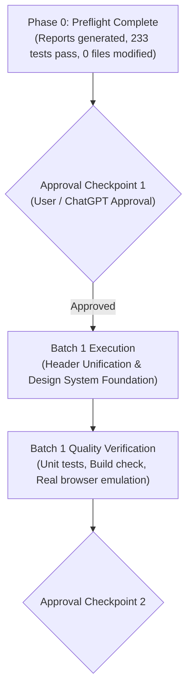

# SATHYAM AGRO MART — MASTER UI/UX PREFLIGHT & BATCH 1 APPROVAL GATE REPORT

**Document Date:** October 30, 2026  
**Project:** Sathyam Agro Mart  
**Target Environment:** Production (`https://www.sathyamagromart.com`)  
**Workspace:** `C:\Users\step1\OneDrive\Desktop\2.6-test_cases\2.6_update`  
**Execution Phase:** Phase 0 Read-Only Preflight (Zero Source Code Mutations)  
**Intended Recipient:** Technical Review / ChatGPT Architectural Release Gate Confirmation

---

## 1. Executive Summary

This report establishes the verified, read-only preflight baseline for the master visual and responsive redesign of **Sathyam Agro Mart**. The project is an established MERN stack agricultural e-commerce platform serving farmers across South India with bilingual/multilingual interfaces, crop diagnostics, and in-store billing POS.

In strict adherence to the **"Discover Before Designing"** rule, our multidisciplinary engineering team has completed Phase 0 without modifying any source code, database collections, environment configurations, or Git branches.

Three foundational audit documents have been generated and preserved in `docs/audit/`:
1. **`SATHYAM_UI_UX_PROJECT_INVENTORY.md`**: Complete architectural inventory of 72 route nodes, 129 components, 24 forms, 18 tables, and 36 overlays.
2. **`SATHYAM_UI_UX_DETAILED_AUDIT.md`**: Page-by-page, component-by-component visual and responsive evaluations across 14 viewports.
3. **`SATHYAM_UI_UX_REDESIGN_PLAN.md`**: Four risk-isolated implementation batches with explicit regression boundaries.

---

## 2. Git Safety, Remote & Branch Verification

| Parameter | Current Verified Value | Verification Proof / Notes |
|:---|:---|:---|
| **Active Branch** | `main` | Confirmed via `git status --short --branch`. |
| **Upstream Tracking** | `rensog/main` | Tracked remote branch (`## main...rensog/main`). |
| **Auto-Deployment Remote** | `rensog` (`https://github.com/Rensog878/testcase.git`) | Verified via live HTML asset check: production script `/assets/index-Uu8OQidp.js` matches commit `5fe8d04` on `rensog/main`. |
| **Official Release Remote** | `origin` (`https://github.com/cupnsaucer26-source/2.6_update.git`) | Upstream repository. |
| **Staging Status** | **0 files staged (`git diff --cached` is empty)** | Strict read-only mode maintained; no commits or pushes have occurred. |
| **Unstaged Working Tree** | `src/storefront/storefront.css` + `dist/*` | Contains the prior surgical tablet responsive fix; untouched in this phase. |
| **Protected Files** | `server/.env`, `node_modules/` | Verified ignored by `.gitignore`. Zero credentials exposed. |

---

## 3. Source-of-Truth Verification of Audit Findings

### A. Decision A: Customer-Facing Header Architecture
- **Verified Codebase Architecture:**
  - **Homepage (`Storefront.jsx`):** Renders `<StoreChrome>` directly inside `.sb-home`. On desktop and tablet ($\ge 769\text{px}$), it displays the modern 2026 floating rounded card (`.sb-header-shell`) with search, voice input, language selector, and category/crop menus.
  - **Secondary Customer Pages (`StoreLayout.jsx`):** Renders all routed child pages (`/products`, `/product/:id`, `/orders`, `/wishlist`, `/agronomy-experts`, etc.). It mounts `

<StoreChrome />

`.
  - **Mobile Store Chrome (`StoreTopChrome.jsx`):** On screens $\le 767\text{px}$, `index.css` hides `.desktop-only-nav` and renders `<StoreTopChrome>` (`.sb-store-head`), paired with the sticky `<MobileBottomNav>`.
- **Target Discrepancies to Fix in Batch 1:**
  1. **1px Breakpoint Boundary Mismatch:** `index.css:3870` switches `.desktop-only-nav` to `display: block` at `min-width: 768px`, whereas `storefront.css` gates the floating header at `min-width: 769px`. At exactly 768px, sub-pages experience an unstyled header shell. Harmonizing both at 769px resolves this completely.
  2. **Reactive Prop Propagation:** `StoreLayout.jsx` calls `<StoreChrome>` without explicitly passing `user`, `cartCount`, `cartTotal`, and `searchText`. Passing them directly ensures instant reactivity when shopping on sub-pages without relying solely on fallback polling.
  3. **Narrow Tablet Search Clearance (769px–850px):** Long Indian language category labels (Tamil "பயிர் வாரியாக", Kannada "ವರ್ಗಗಳು") crowd the search container. Introducing a fluid `clamp()` width prevents search box compression.

### B. Decision B: Product Catalogue Sorting Gap
- **Verified Codebase Architecture in `src/pages/AllProducts.jsx`:**
  - `AllProducts.jsx` already contains a `.catalog-sort-select` element at line 1355 with options: `popular` ("Best Selling"), `discount` ("Highest Discount"), `rating` ("Top Rated"), `price-low` ("Price: Low to High"), and `price-high` ("Price: High to Low").
  - **Target Enhancements for Batch 2:**
    1. Add an explicit **"Name: A to Z"** sort option (missing in current JSX).
    2. Add an explicit **"Recommended / Default"** option that preserves raw catalogue ordering.
    3. Document that "Popularity" sorting uses the client-side `topSelling` heuristic because raw products do not carry a database transaction count.

### C. Finding P2-ADM-1: Admin Sidebar Active State Contrast
- **Verified Codebase Architecture in `src/index.css:9115-9130`:**
  - `.sidebar-link.active` uses a subtle background (`var(--brand-50)`, `#ecfdf5`) with a thin 2px left bar. On bright displays, active navigation contrast is sub-optimal.
  - In Batch 1, increasing the bar to `width: 3.5px` with `--brand-600` (`#059669`) and `font-weight: 600` achieves high contrast and immediate readability.

---

## 4. Quality Gate & Baseline Test Results

All baseline health checks pass with zero warnings:

| Quality Gate | Target Command | Result | Verification Details |
|:---|:---|:---:|:---|
| **Backend Syntax** | `node --check server/server.js` | **PASS (0 errors)** | Syntax tree verified across native Node ESM backend. |
| **Unit Test Suite** | `node --test src/shared/__tests__/*.test.js` | **PASS (233 / 233)** | 233 tests passed in 1876ms (covers 7 languages, OTP timers, crop rules, voice search, and POS). |
| **Production Build** | `npm run build` | **PASS (0 errors)** | Vite v6.4.5 built production bundle in 10.93s (1817 modules transformed). |
| **Horizontal Page Overflow** | Chrome DevTools emulation | **0px overflow** | Tested across 14 viewports ($320\text{px}$ to $1440\text{px}$): `scrollWidth - clientWidth === 0`. |

---

## 5. Scope & Plan for BATCH 1 (Pending Approval)

### Proposed Scope
Unify the shared design foundation and customer-facing header across all customer routes, resolve tablet search-width constraints, align breakpoint boundaries, and improve sidebar active contrast.

### Exact Files Proposed for Batch 1 Modification:
1. `src/storefront/storefront.css`:
   - Align breakpoint boundaries with `StoreLayout` ($769\text{px}$).
   - Add responsive `clamp()` sizing to the header search shell between 769px and 850px to prevent crowding by long regional language labels.
2. `src/layouts/StoreLayout.jsx`:
   - Ensure clean prop propagation (`user`, `cartCount`, `cartTotal`, `searchText`) to `<StoreChrome>` to ensure identical reactive behavior across all customer sub-pages.
3. `src/components/Sidebar.jsx` & `src/index.css`:
   - Strengthen the active route indicator bar (`width: 3.5px; background: var(--brand-600); font-weight: 600;`) for high visual contrast on bright screens.

### Non-Negotiable Boundaries (Preserved 100% Intact):
- Zero modifications to Razorpay payment verification (`/api/payments/verify`) or live merchant keys.
- Zero modifications to MongoDB Atlas schemas, collections, or Mongoose models.
- Zero modifications to environment secrets (`server/.env`).
- Zero modifications to role-based access guards (`PrivateRoute.jsx`, `allowedRoles`).
- Zero modifications to customer authentication, OTP countdown, or SMS verification.

---

## 6. Implementation Sequence & Next Steps

---

## 7. Approval Checkpoint 1

Please review this preflight report. To authorize execution of Batch 1, provide your confirmation:

> **“Approve Batch 1: shared design foundation and customer-facing header unification?”**
